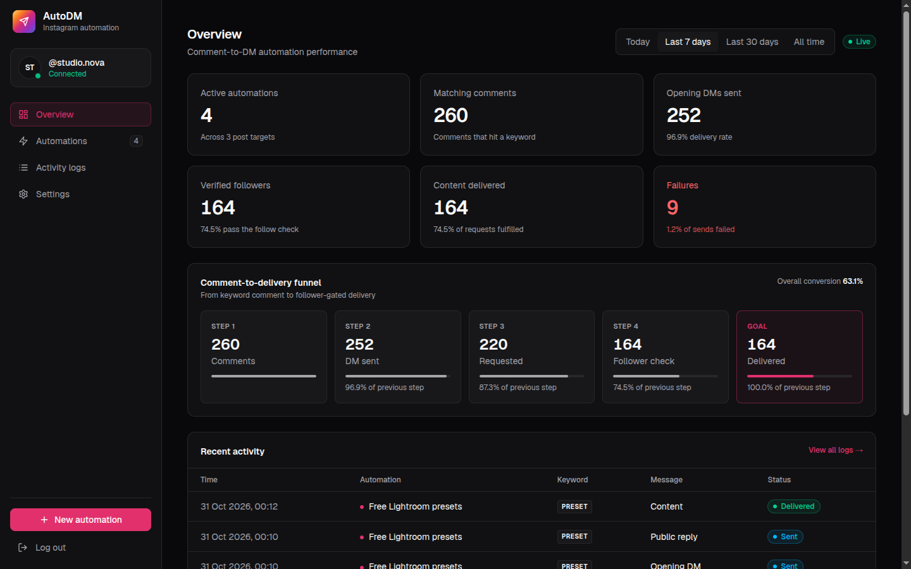
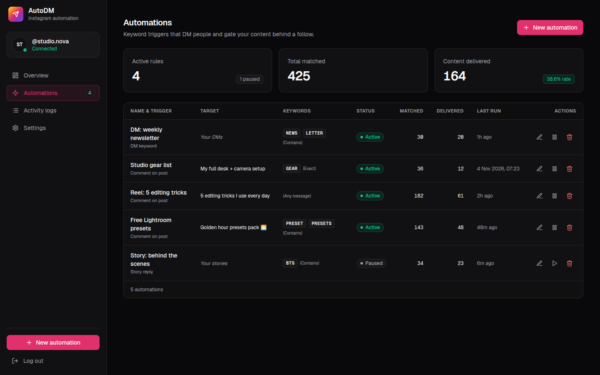
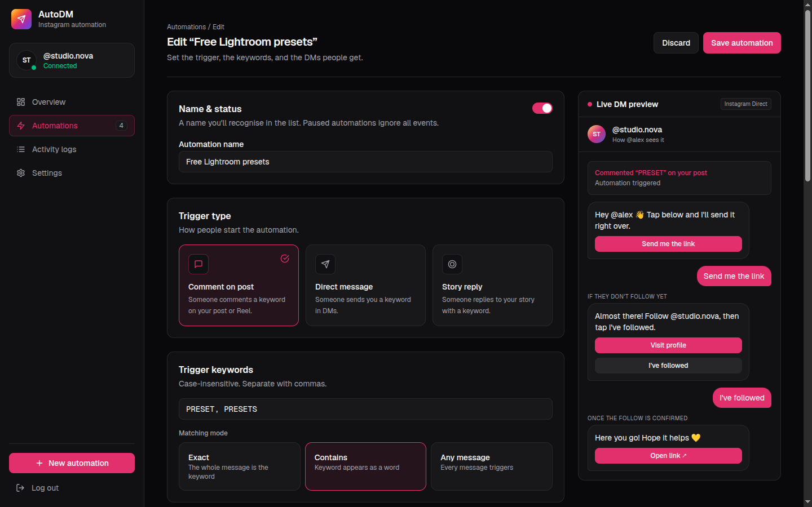
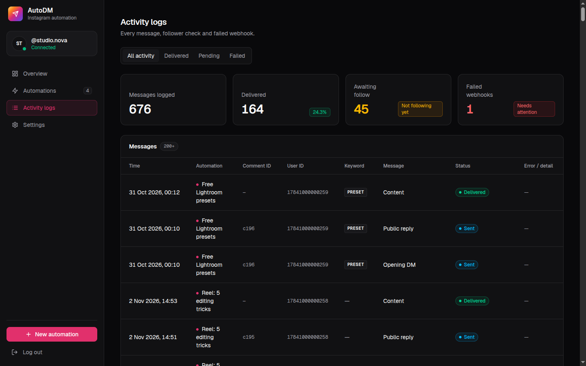
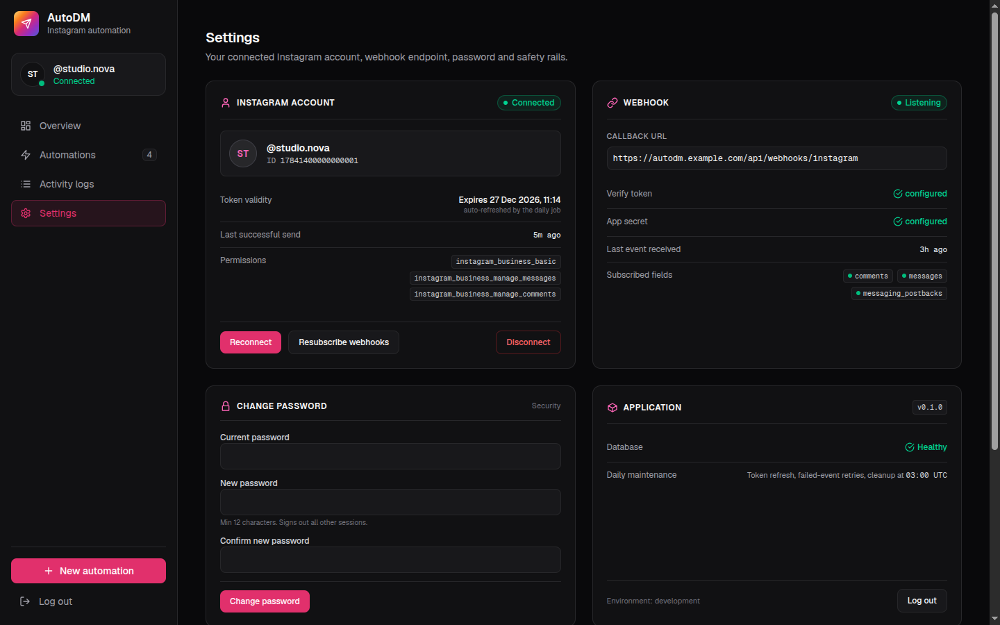
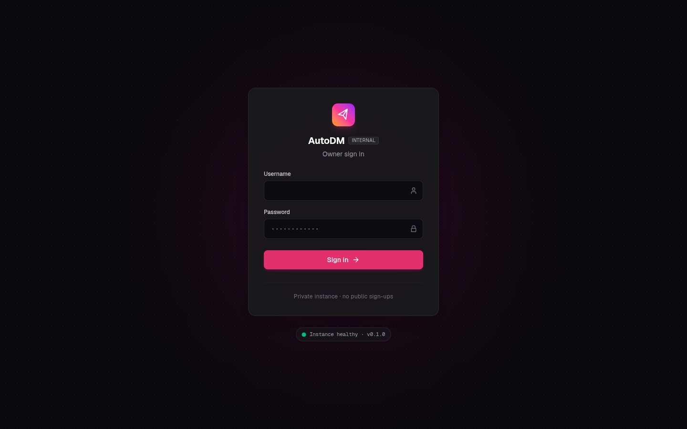

<div align="center">


# AutoDM: Open-Source Instagram Comment-to-DM Automation

**Self-hosted Instagram auto-DM tool with a real follow-to-unlock gate. A free, private alternative to paid DM automation SaaS.**

Someone comments on your post or Reel → they get a DM → they tap a button → AutoDM checks
that they actually follow you → only then does the link land in their inbox.
One owner, one Next.js app, official Meta APIs. No scraping, no browser bots, no Instagram password.

`Next.js 16 (one deployment)` · `Turso / libSQL` · `Vercel` · `Instagram API with Instagram Login`




</div>

---

## 📖 What is AutoDM?

AutoDM is a **self-hosted Instagram DM automation** app for creators and small brands. It turns comments, DMs
and story replies into automatic Instagram direct messages: **comment a keyword (or anything at all) → get the
link in your DMs**. Unlike most "comment to DM" tools, it can **require a follow before delivering the link**, and
it checks the follow live through the official Instagram API instead of trusting a cached answer.

It's a good fit if you want to:

- **Grow Instagram followers** with follow-to-unlock content (presets, guides, discount pages, blog posts)
- **Automatically send links in Instagram DMs** when people comment on a Reel
- **Run Instagram auto-replies** on comments without paying a monthly per-contact SaaS fee
- **Keep your data** in your own database on your own Vercel deployment


## ✨ What it does

- **Comment → DM**: a keyword comment (or **any comment**) on one specific post/Reel, or on any post, triggers a Meta **Private Reply**, the purpose-built comment-to-DM channel.
- **Automation webhook**: `POST` a post id + link from Make, Zapier, n8n or a script and AutoDM creates the automation for that Reel, with a random message template.
- **Ready-made message templates**: pick a tone (classic, hype, minimal, mystery, curious) instead of writing every DM from scratch.
- **DM keyword replies**: someone DMs you `GUIDE` and the flow starts straight away.
- **Story reply triggers**: someone replies `GUIDE` to your story and gets the same flow, routed to its own automations.
- **Follow-to-unlock gate**: tapping **"Send me the link"** runs a follower check (`is_user_follow_business`):
  - ✅ **following** → content message + tappable link button (plain-text fallback if Meta rejects the template)
  - 👋 **not following** → "Visit profile" + "I've followed" buttons; tapping rechecks
  - ⚠️ **unknown / API error** → content is **held back**, with a friendly error and a "Try again" button
- **Public comment replies**: optionally reply under the comment with a random line from your list ("Sent! Check your DMs 📬").
- **Three match modes**: `exact`, `contains` (whole word), or `any`. Always case-insensitive and emoji/punctuation tolerant.
- **`{username}` personalization**: greet commenters by their @handle.
- **Live DM preview**: the automation editor renders an Instagram-style chat preview as you type.
- **Dashboard**: conversion funnel (comment → DM → request → follow check → delivered), activity logs with filters, follower-check history, failed-webhook list with one-click **Retry now**.

## 🛡️ Built to keep your Instagram account safe

| Rule | How it's enforced |
|---|---|
| No duplicate sends | `webhook_events.event_key` is unique; partial unique indexes on `dm_logs` allow one opening DM per comment and one content delivery per person per automation |
| Fail closed | An unknown follower status **never** releases the content |
| ~200 DMs/hour Meta limit | Capped at **180/hour** per account, leaving room for your own DMs |
| 24-hour messaging window | DM events older than 24h are never answered |
| Policy blocks (Meta error 368) | **Circuit breaker**: all sends pause for 24h instead of retrying into a ban |
| Rate-limit errors (4/17/32/613) | No fallback burst, event left for retry |
| Expired token (error 190) | Account marked expired, dashboard banner, automations stop |
| Webhook authenticity | HMAC-SHA256 over the raw body, timing-safe compare (Instagram **or** Facebook app secret) |
| Tokens at rest | AES-256-GCM encrypted, auto-refreshed by the daily cron when < 30 days remain |

## 🏗️ Architecture

One Next.js app. No Redis, no worker servers, no queue service.

```
Instagram comment / DM / story reply
          │
          ▼
Meta webhook ──► /api/webhooks/instagram ── verify HMAC ── store + dedup event ── 200 OK
                                                  │
                                                  ▼
                            claim event atomically (UPDATE … RETURNING)
                            match automation → keyword → window / pause / hourly cap
                                                  │
                     ┌────────────────────────────┴───────────────────────┐
             private reply + "Send me the link"               failed → kept with error
                     │                                         → daily cron retries (3×, 6 days)
                     ▼                                         → or "Retry now" in Logs
        postback UNLOCK:<id> → follower check
          ├─ following      → content + link button
          ├─ not following  → follow prompt, recheck on tap
          └─ unknown        → held back, "Try again"
```

- **Turso / libSQL** stores everything: owner + sessions, the Instagram connection, automations, webhook events, follower checks and message logs.
- **Vercel Cron** hits `/api/cron` daily for token refresh, event retries and cleanup.
- **Server Actions** handle every dashboard mutation; each one checks the owner session, and Next.js checks the Origin header (CSRF).

## 🖥️ Screenshots

> Screenshots use demo data (fake account `@studio.nova`), not real users.

| Automations list | Automation editor with live DM preview |
|---|---|
|  |  |

| Activity logs | Settings |
|---|---|
|  |  |

<details>
<summary>Login screen</summary>

</details>

## 🚀 Quick start

You need: Node 24+, a [Meta developer](https://developers.facebook.com) app, and (for production) [Turso](https://turso.tech) + [Vercel](https://vercel.com).

```bash
# 1. Install
npm install

# 2. Configure env
cp .env.example .env.local
#    → fill APP_ENCRYPTION_KEY, META_*, CRON_SECRET (each one is explained in the file)

# 3. Create the owner (there is no signup page, on purpose)
npm run hash-password            # paste OWNER_USERNAME + OWNER_PASSWORD_HASH into .env.local
npm run db:migrate               # creates tables and the single owner
#    → then delete OWNER_USERNAME / OWNER_PASSWORD_HASH from .env.local

# 4. Run
npm run dev
```

Meta needs a public HTTPS URL for OAuth and webhooks. Use a tunnel (`cloudflared tunnel --url http://localhost:3000`
or ngrok) and set `META_REDIRECT_URI` to `https://<tunnel>/api/instagram/callback`.

<details>
<summary><b>📱 Meta app setup</b></summary>

1. developers.facebook.com → your app → **Instagram → API setup with Instagram login**.
2. Permissions: `instagram_business_basic`, `instagram_business_manage_messages`, `instagram_business_manage_comments`.
3. **Business login settings → OAuth redirect URI:** exactly your `META_REDIRECT_URI`.
4. **Webhooks:** callback `https://<domain>/api/webhooks/instagram`, verify token = `META_WEBHOOK_VERIFY_TOKEN`;
   subscribe to `comments`, `messages`, `messaging_postbacks`.
5. In AutoDM: **Settings → Connect Instagram**. This also subscribes your account to the webhook fields
   (use **Resubscribe webhooks** if events stop arriving).
6. Instagram app → Settings → Messages and calls → **Connected tools → allow access to messages**.

**Development mode** only delivers events from accounts with a role on the app, so add a second Instagram account as a
tester to try it end to end. To trigger on the public, submit **App Review** for Advanced Access on the two
`manage_*` permissions with a screencast of the working flow.

</details>

<details>
<summary><b>☁️ Production on Vercel</b></summary>

1. `turso db create autodm && turso db show autodm --url && turso db tokens create autodm`.
   Create a **separate** database for Preview so previews never touch production automations.
2. Set all env vars in Vercel **per environment** (Production / Preview). `META_REDIRECT_URI` = your production domain.
3. Run migrations against production once from your machine:
   ```bash
   DATABASE_URL=libsql://... DATABASE_AUTH_TOKEN=... OWNER_USERNAME=... OWNER_PASSWORD_HASH='...' npm run db:migrate
   ```
   The owner row is pinned to `id = 1`, so setup can never create a second owner. `OWNER_*` never go to Vercel.
4. Deploy. `vercel.json` schedules `/api/cron` daily at 03:00 UTC.
5. Backups: Turso keeps point-in-time restore; `turso db shell autodm .dump > backup.sql` for a manual copy.

</details>

## 🔐 Security model

- **One owner, no registration.** Created once through `db:migrate`, enforced by a `CHECK (id = 1)` constraint.
- **Passwords**: Argon2id, never stored or logged in plaintext. Changing it signs out every other session.
- **Sessions**: random tokens, only their SHA-256 hash is stored; `HttpOnly`, `SameSite=Lax`, `Secure` in production, 7-day expiry.
- **Login rate limit**: 5 failures per IP and 30 globally per 15 minutes, with a generic error message.
- **Instagram tokens**: AES-256-GCM encrypted at rest, decrypted only at send time, never logged.
- **OAuth**: state cookie checked on callback.
- **Webhooks**: signature verified before anything else runs.

## 🧰 Scripts & endpoints

| Command | What it does |
|---|---|
| `npm test` | Keyword matching, URL validation, templating, webhook signature checks |
| `npm run db:migrate` | Apply `migrations/*.sql` (tracked in `_migrations`) |
| `npm run hash-password` | Print an Argon2id hash for the owner |

| Path | Who | Purpose |
|---|---|---|
| `GET/POST /api/webhooks/instagram` | Meta | Subscription handshake / signed events |
| `GET /api/instagram/connect`, `/callback` | Owner | OAuth |
| `POST /api/automations/webhook` | You (`Bearer AUTOMATION_WEBHOOK_SECRET`) | Create/update an any-comment automation for a post: `{ "post": "<media id or link>", "url": "https://…" }` |
| `POST /api/webhooks/zernio` | Zernio (signed) | Button taps from Zernio-sent DMs; re-checks the follow live |
| `GET /api/cron` | Vercel Cron (`Bearer CRON_SECRET`) | Token refresh, retries, cleanup |
| `GET /api/health` | Anyone | DB reachability + version |

## ❓ FAQ

<details>
<summary><b>Is it safe to automate Instagram DMs?</b></summary>

AutoDM only uses Meta's official Instagram Platform APIs (Private Replies + Messaging), stays under the hourly DM
limit, answers only inside the 24-hour messaging window and pauses itself on a policy block. It never logs in with
your password or automates a browser.
</details>

<details>
<summary><b>Can it DM people who comment anything, not just a keyword?</b></summary>

Yes. Pick the **Any message** match mode and every comment on that post triggers the DM. Automations created through
the webhook use any-comment by default.
</details>

<details>
<summary><b>Does it really check that someone follows me?</b></summary>

Yes. The follow check runs live on every "I've followed" tap. If Instagram can't confirm it, the link is held back
instead of being sent anyway.
</details>

<details>
<summary><b>How is this different from ManyChat or other comment-to-DM tools?</b></summary>

AutoDM is open source and self-hosted: no per-contact pricing, your data stays in your own database, and the follow
gate fails closed. It does one job (comment/DM/story reply → follow check → link), not full chatbot flows.
</details>

<details>
<summary><b>Do I need Meta App Review?</b></summary>

In development mode only accounts with a role on your Meta app trigger it. For the public, either pass App Review for
the `manage_messages` / `manage_comments` permissions, or connect [Zernio](https://zernio.com), whose approved app
delivers comments from anyone.
</details>

## 📏 Known limits

- The cron runs daily (Vercel Hobby limit), so automatic retries can take up to a day. Use **Retry now** in Logs, or tighten the schedule on Pro.
- Content is delivered once per person per automation; a second tap after delivery does nothing.
- One Instagram account per install.

## ⚠️ Disclaimer

- AutoDM talks to Instagram **only** through Meta's official APIs, using **your own** Meta app and credentials
  (or, if you set `ZERNIO_API_KEY`, through Zernio's Meta-approved app).
  It never scrapes, never automates a browser, and never asks for your Instagram password.
- The safety rails are designed to keep you inside Meta's published limits, but **you** are responsible for how
  you use automation and for complying with Instagram's Terms of Use and Meta's Platform Policies.
- Not affiliated with, endorsed by, or sponsored by Meta or Instagram.

---

<div align="center">

Built with ❤️ for creators who'd rather make content than copy-paste links.

<sub>Instagram comment to DM · Instagram auto DM · auto reply to Instagram comments · send link in Instagram DM ·
follow to unlock · Instagram DM automation · open-source ManyChat alternative · Next.js · Vercel</sub>

</div>
